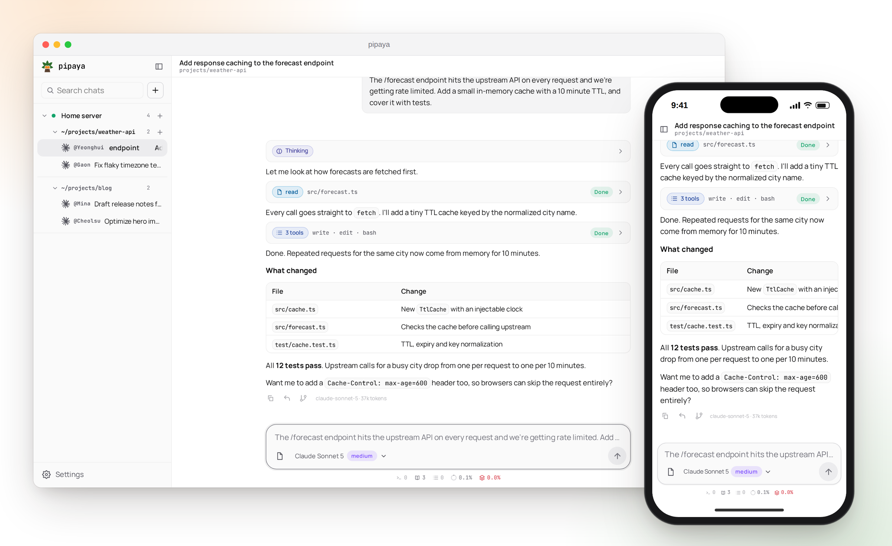

<div align="center">
  <picture>
    <source media="(prefers-color-scheme: dark)" srcset=".github/assets/banner.ko-dark.svg" />
    
  </picture>

  <p align="center"><a href="README.md">English</a> · <b>한국어</b></p>

  <p align="center"><b>내 서버에서 돌리는 AI 에이전트 채팅 도구.</b><br />세션, 설정, API 키는 내 서버의 SQLite에만 저장되며 클라우드 계정이 필요 없습니다.</p>

  <p align="center">
    <a href="https://bun.sh" target="_blank" rel="noreferrer"></a>
    <a href="https://fastify.dev" target="_blank" rel="noreferrer"></a>
    <a href="https://svelte.dev" target="_blank" rel="noreferrer"></a>
    <a href="https://tauri.app" target="_blank" rel="noreferrer"></a>
    <a href="https://www.typescriptlang.org" target="_blank" rel="noreferrer"></a>
    <a href="https://www.sqlite.org" target="_blank" rel="noreferrer"></a>
    
    <a href="LICENSE"></a>
    <a href="https://discord.gg/rn3uEghsjh" target="_blank" rel="noreferrer"></a>
  </p>
</div>

<p align="center">
  <picture>
    <source media="(prefers-color-scheme: dark)" srcset=".github/assets/preview-dark.png" />
    
  </picture>
</p>

## 주요 기능

- **내장 도구 에이전트**: read, write, edit, ls, grep, bash. 나머지는 확장으로 추가
- **어떤 모델이든**: 내장 제공자, 로컬 서버(Ollama, LM Studio, llama.cpp, vLLM), 직접 만든 엔드포인트
- **여러 기기, 하나의 대화**: Windows, macOS, Android, 웹
- **분할 화면**: 한 화면에 대화 최대 8개
- **확장 가능**: AGENTS.md, 스킬, 템플릿, 하위 에이전트, 서버·클라이언트 확장

## 설치

| 클라이언트 | 설치 방법 |
|---|---|
| Windows x64 | `irm https://raw.githubusercontent.com/dohwi/pipaya/main/install.ps1 \| iex` |
| macOS (Apple Silicon) | `curl -fsSL https://raw.githubusercontent.com/dohwi/pipaya/main/install.sh \| bash -s -- client` |
| Android, Linux, 웹 |  [위키](https://github.com/dohwi/pipaya-wiki) 참고 |

Windows·macOS 앱은 서버를 내장합니다. 휴대폰·웹·여러 기기용 headless 서버는 다음으로 설치합니다.

```bash
curl -fsSL https://raw.githubusercontent.com/dohwi/pipaya/main/install.sh | bash
```

Docker, 설정 등 나머지는 [위키](https://github.com/dohwi/pipaya-wiki)를 보세요.

## 보안

토큰은 **관리자 권한**이고, API 키는 **암호화 없이** 저장되며, `bash`는 **샌드박스가 아닙니다**. Tailscale이나 HTTPS로만 접근하세요. 취약점은 [SECURITY.md](SECURITY.md)에 따라 비공개로 제보하세요.

## 개발

```bash
mise install                          # Bun, Rust
cd server && bun install && bun run dev
cd client && bun install && bun run dev    # 웹 클라이언트 (포트 1420)
```

[CONTRIBUTING.md](CONTRIBUTING.md)와 [`server/README{".ko" if ko else ""}.md`](server/README{".ko" if ko else ""}.md)를 보세요.

## 라이선스

[MIT](LICENSE)
