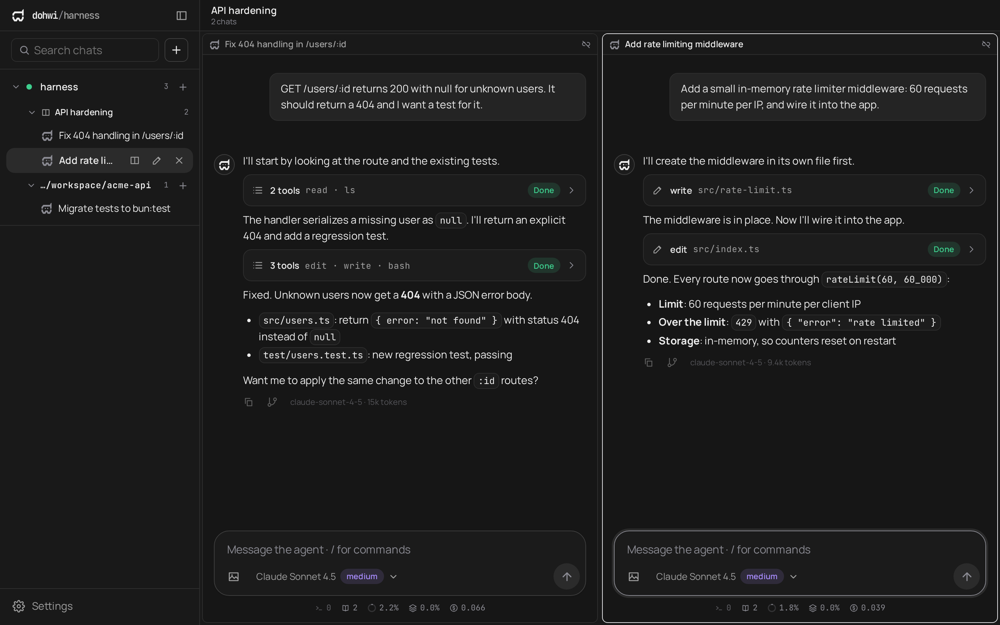
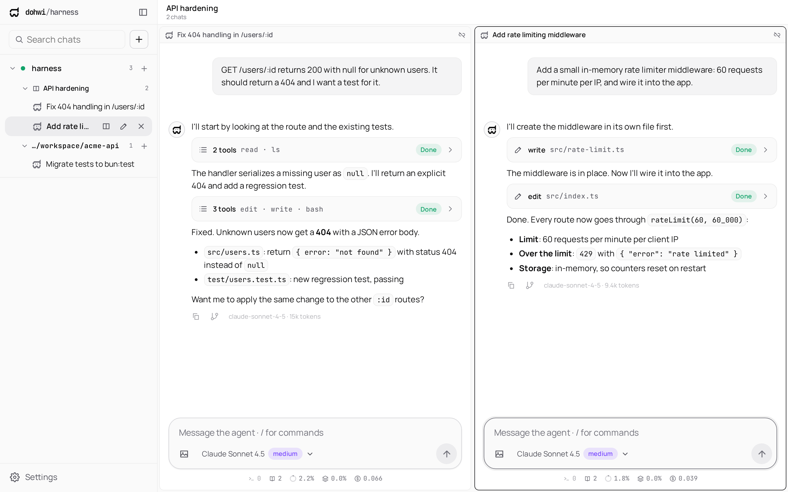
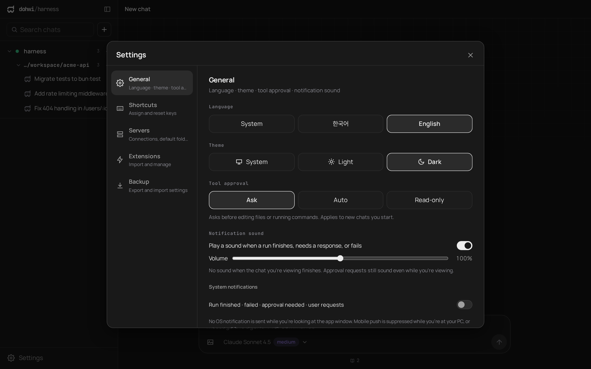
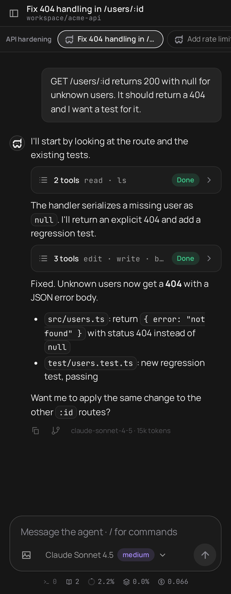

<div align="center">
  
  <h1>pipaya</h1>
  <p>직접 호스팅하는 LLM 코딩 에이전트 하네스: Bun + Fastify API 서버와 Svelte 5 + Tauri 2 채팅 클라이언트.</p>

  <p><a href="README.md">English</a> · <b>한국어</b></p>

  <p>
    <a href="https://bun.sh" target="_blank" rel="noreferrer"></a>
    <a href="https://fastify.dev" target="_blank" rel="noreferrer"></a>
    <a href="https://svelte.dev" target="_blank" rel="noreferrer"></a>
    <a href="https://tauri.app" target="_blank" rel="noreferrer"></a>
    <a href="https://www.typescriptlang.org" target="_blank" rel="noreferrer"></a>
    <a href="https://www.sqlite.org" target="_blank" rel="noreferrer"></a>
    <a href="#docker로-서버-실행-sandbox"></a>
    <a href="LICENSE"></a>
  </p>

  <p>
    <a href="#quick-install"><b>설치</b></a> ·
    <a href="#docker로-서버-실행-sandbox"><b>Docker 샌드박스</b></a> ·
    <a href="#클라이언트"><b>다운로드</b></a> ·
    <a href="server/README.ko.md">서버 문서</a> ·
    <a href="client/README.ko.md">클라이언트 문서</a>
  </p>
</div>

---

## Preview

<p align="center">
  
  <br />
  <sub>세션 그룹: 여러 에이전트를 나란히 실행합니다. 각 대화는 자체 도구, 모델, 승인 정책을 가집니다.</sub>
</p>

| 라이트 테마 | 설정 |
| :---: | :---: |
|  |  |

<p align="center">
  
  <br />
  <sub>모바일에서도 같은 클라이언트를 사용합니다.</sub>
</p>

## Overview

`pipaya`는 LLM 코딩 에이전트를 실행하는 API 전용 **서버**(`server/`)와, 이를 조작하는 데스크톱·모바일·웹 **클라이언트**(`client/`)로 구성된 모노레포입니다.
서버는 세션, 도구 실행, 승인 정책, 모델 연결 설정을 관리하고 REST로 명령을, SSE/WebSocket으로 진행 상황을 전달합니다.

모델은 직접 연결합니다. 내장 프로바이더가 없고, API 키는 서버 밖으로 나가지 않습니다.

## Features

### 에이전트와 안전

- **Custom-only 모델 연결**: OpenAI Chat Completions / Responses / Anthropic Messages 형식의 엔드포인트를 직접 등록하며, API 키는 서버 SQLite에만 저장됩니다.
- **도구 승인 정책**: 세션마다 `auto` / `ask` / `readonly`를 지정합니다. `ask`에서는 변경성 도구(`write`, `edit`, `bash`) 호출이 사용자 승인을 기다리고, 시간 초과 시 자동 거부됩니다.
- **작업 디렉터리 격리**: 파일 도구는 세션 cwd 밖(심볼릭 링크 경유 포함)을 열 수 없고, `bash`에는 서버의 `HARNESS_*` 환경변수가 전달되지 않습니다.
- **스킬 / AGENTS.md**: 전역·프로젝트 스킬을 검색해 시스템 프롬프트에 노출하고, 첫 실행 시점의 지침을 세션에 고정합니다.
- **Docker 샌드박스**: 서버를 강화된 컨테이너에서 실행해 에이전트의 명령이 호스트에 닿지 않게 합니다([자세히](#docker로-서버-실행-sandbox)).

### 사용 경험

- **한국어·영어 UI**: 클라이언트에 두 언어가 내장되어 있고 기기 언어를 따릅니다. 다른 언어는 언어팩 확장으로 추가하며, 서버(`GET/PUT /locales`)를 통해 기기 간에 공유됩니다.
- **클라이언트 확장**: 확장 코드는 opaque-origin iframe 안의 Worker(네트워크 차단 CSP)에서 실행되며, 권한이 검사되는 MessagePort로만 호스트와 통신합니다.
- **자동 업데이트**: Windows·macOS 앱은 서명을 확인한 뒤 스스로 업데이트하고, Android는 새 빌드가 나오면 알려 줍니다. 설정 → 일반에서 확인하세요.
- **알림**: 데스크톱·웹 OS 알림(창에 포커스가 있으면 억제)과, Firebase Cloud Messaging을 통한 선택적 Android 푸시.
- **실시간 이벤트 스트림**: 전역 증가 커서 기반 SSE / WebSocket. `Last-Event-ID`로 끊김 없이 재생합니다.
- **세션 그룹**: 분할 창 레이아웃과 여러 서버 연결을 지원합니다.

<details>
<summary>세션 그룹 동작 방식</summary>

- 그룹은 만들어 두고 채우는 것이 아니라, 사이드바에서 대화를 다른 대화 위로 끌어다 놓는 순간 만들어집니다. 그룹의 대화가 하나만 남으면 자동으로 해제됩니다(서버가 최소 2개를 강제).
- 단축키로도 분할됩니다: 선택한 창을 기준으로 `Ctrl+\`(오른쪽)·`Ctrl+Shift+\`(아래)에 새 대화를 만들어 바로 그룹으로 묶습니다. 왼쪽·위 분할은 설정의 단축키에서 키를 지정하면 됩니다. 새 대화는 분할한 창과 같은 작업 폴더·모델에서 시작합니다.
- 화면에 끌어다 놓을 때는 가운데 영역이 없고, 놓은 지점에서 가장 가까운 상하좌우 변으로 분할됩니다.

</details>

## Quick Install

서버를 어떻게 실행할지 고르세요.

| 방식 | 적합한 경우 | 격리 |
|---|---|---|
| [**호스트 설치**](#서버-linux-macos) | 내 컴퓨터나 서버에서 일상적으로 사용 | 없음: 도구가 내 사용자 권한으로 실행 |
| [**Docker (Sandbox)**](#docker로-서버-실행-sandbox) | 에이전트의 명령을 호스트와 분리 | 컨테이너, 비특권, 읽기 전용 루트 |
| [**소스에서 실행**](#getting-started-개발) | 개발 | 없음 |

어느 방식이든 서버 URL과 토큰을 얻게 됩니다. 그다음 [클라이언트](#클라이언트)를 설정하세요.

### 서버 (Linux, macOS)

```bash
curl -fsSL https://raw.githubusercontent.com/pipaya/main/install.sh | bash
```

`git`과 `curl`이 필요합니다. 설치 스크립트는 (확인 후) Bun을 설치하고, 서버를 `~/.local/share/pipaya`에 받아 **사용자 서비스**(systemd 또는 launchd)로 실행합니다. 서비스는 크래시나 강제 종료 후 **자동으로 재시작**되고 부팅 시 시작됩니다(Linux에서는 이를 위해 가능하면 `loginctl enable-linger`도 설정합니다). root 권한은 사용하지 않습니다.

- **주소**: Tailscale이 설치되어 있으면 **Tailscale 주소**, 없으면 `127.0.0.1`에서만 수신합니다. `--host 0.0.0.0`은 방화벽 뒤에서만 쓰세요.
- **토큰**: `~/.pipaya/token`(권한 `0600`)에 생성됩니다.
- **승인 정책**: 기본값은 `ask`입니다.

```bash
curl -fsSL https://raw.githubusercontent.com/pipaya/main/install.sh | bash -s -- --port 9000 --approval ask
bash ~/.local/share/pipaya/install.sh update      # 최신 코드로 갱신하고 재시작
bash ~/.local/share/pipaya/install.sh status
bash ~/.local/share/pipaya/install.sh uninstall   # ~/.pipaya 데이터는 남깁니다
```

모든 옵션은 `install.sh --help`로 확인합니다. 실행 전에 내용을 검토하려면 먼저 내려받으세요: `curl -fsSLO https://raw.githubusercontent.com/pipaya/main/install.sh`.

### Docker로 서버 실행 (Sandbox)

에이전트의 `bash`, `write`, `edit` 도구가 호스트를 건드리지 않게 하려면 서버를 컨테이너에서 실행하세요. Docker와 Compose만 있으면 됩니다.

```bash
git clone https://github.com/dohwi/pipaya.git && cd pipaya
docker compose up -d --build
docker compose exec harness cat /data/token      # 인증 토큰
```

서버는 `http://127.0.0.1:8787`에서 열립니다.

| 항목 | 내용 |
|---|---|
| **에이전트가 닿는 범위** | 컨테이너 안뿐입니다. 작업 폴더는 `workspace` 볼륨이라 홈 디렉터리나 다른 프로젝트가 보이지 않습니다. |
| **호스트 프로젝트에서 작업** | `compose.yaml` 옆 `.env`에 `HARNESS_WORKSPACE_DIR=/path/to/project`를 지정하세요. 그 폴더는 에이전트가 수정·삭제할 수 있습니다. |
| **강화 설정** | 비특권 사용자(uid 10001), 읽기 전용 루트 파일시스템, Linux capability 전체 제거, `no-new-privileges`, 메모리 2GB·CPU 2개·프로세스 512개 제한(`HARNESS_MEM_LIMIT`, `HARNESS_CPUS`). |
| **네트워크** | `127.0.0.1`로만 공개됩니다. 휴대폰에서 접속하려면 `HARNESS_BIND`를 Tailscale 주소로 지정하세요. 공인 주소는 쓰지 마세요. |
| **데이터** | 세션, API 키, 토큰은 `data` 볼륨에 있습니다. 백업하세요. `docker compose down -v`는 이를 삭제합니다. |
| **포함된 도구** | `git`, `ripgrep`, `bash`. 프로젝트에 필요한 것(node, python 등)은 [server/Dockerfile](server/Dockerfile)에 추가하세요. |
| **로컬 모델 서버** | 컨테이너에서는 호스트의 `localhost`가 보이지 않습니다. `compose.yaml`의 `extra_hosts` 주석을 풀고 연결 URL을 `http://host.docker.internal:11434/v1`로 등록하세요. |

> [!WARNING]
> 샌드박스는 잘못된 명령의 피해 범위를 줄여 줄 뿐, 완전한 보안 경계는 아닙니다. 컨테이너는 LAN을 포함한 네트워크에 여전히 접근할 수 있고, 마운트된 작업 폴더는 완전히 제어합니다. `/var/run/docker.sock`이나 민감한 폴더를 마운트하지 마세요.

### 클라이언트

모든 플랫폼은 [최신 릴리스](https://github.com/dohwi/pipaya/releases/tag/latest)에 있습니다. Windows·macOS 스크립트는 내려받은 파일을 `SHA256SUMS.txt`와 대조하고, 일치하지 않으면 중단합니다.

| 플랫폼 | 설치 |
|---|---|
| Windows x64 | `irm https://raw.githubusercontent.com/pipaya/main/install.ps1 \| iex` |
| macOS (Apple Silicon) | `curl -fsSL https://raw.githubusercontent.com/pipaya/main/install.sh \| bash -s -- client` |
| Android ARM64 | 릴리스의 서명된 APK |
| iOS ARM64 | 릴리스의 unsigned IPA. 그대로 설치할 수 없으며 Apple 서명·프로비저닝이 필요합니다 |

> [!NOTE]
> Windows 설치 파일은 코드 서명이 없고 macOS DMG는 ad-hoc 서명만 되어 있고 공증되지 않아, 첫 실행 때 OS 경고가 나올 수 있습니다.
>
> - **macOS 첫 실행 시 보안 허용**: "확인되지 않은 개발자가 배포했기 때문에 열 수 없습니다" 또는 "악성 소프트웨어가 있는지 확인할 수 없습니다" 경고가 나타나면, **시스템 설정 → 개인정보 보호 및 보안**의 '보안' 섹션에서 **'확인 없이 열기' (Open Anyway)** 를 클릭하세요. 또는 Finder의 `/Applications`에서 앱을 우클릭(또는 Control-클릭)한 뒤 **열기**를 선택하고 팝업에서 **열기**를 누르면 됩니다.
> - **터미널에서 격리 플래그 해제**: `xattr -cr /Applications/pipaya.app` 명령어로 Gatekeeper 격리 속성을 직접 제거할 수도 있습니다.

**연결**: 클라이언트를 열어 서버 URL과 토큰을 입력한 뒤, Settings → Models에서 모델 연결을 추가하세요.

<details>
<summary>릴리스 빌드 방식</summary>

`main`의 클라이언트 변경 시 GitHub Actions가 네 플랫폼을 빌드하고, 모든 검증이 성공하면 고정된 `latest` Release의 파일만 교체합니다. 서버는 포함되지 않으며, 설치된 Windows·macOS 앱은 이를 통해 스스로 업데이트합니다([앱 내 업데이트](client/docs/releases.md#in-app-updates)).

빌드 환경·Android 서명·배포 운영: [client/docs/releases.md](client/docs/releases.md).

</details>

## Tech Stack

| Domain | Technology / Specification |
|---|---|
| Server Runtime | Bun 1.3 / TypeScript 5.x |
| HTTP & Realtime | Fastify 5, `@fastify/websocket`, SSE |
| Agent Core | `@earendil-works/pi-agent-core`, `@earendil-works/pi-ai` |
| Validation | TypeBox |
| Storage | SQLite (`bun:sqlite`, WAL) |
| Client | Svelte 5, Vite 8, marked + DOMPurify |
| Desktop / Mobile | Tauri 2 (Rust, edition 2021) |
| Containerization | Docker / Docker Compose |

## Getting Started (개발)

[mise](https://mise.jdx.dev)로 런타임을 준비합니다.

```bash
mise trust
mise install
```

서버(`http://0.0.0.0:8787`)와 클라이언트(`http://0.0.0.0:1420`)를 터미널 두 개에서 실행합니다.

```bash
# 터미널 1: 서버
cd server && bun install && bun run dev

# 터미널 2: 클라이언트
cd client && bun install && bun run dev
```

서버를 처음 실행하면 인증 토큰이 `~/.pipaya/token`에 생성됩니다 (`HARNESS_TOKEN`으로 지정 가능). 클라이언트 연결은 [클라이언트](#클라이언트)를 따르세요.
데스크톱 앱은 `bun run tauri dev`로 실행합니다 (Linux는 webkit2gtk-4.1 필요).

테스트:

```bash
cd server && bun run typecheck && bun test
cd client && bun run check && bun test tests
```

## Configuration

서버는 `server/.env`(참고: [server/.env.example](server/.env.example)) 또는 환경변수로 설정합니다.

| Variable | Default | Purpose |
|---|---|---|
| `HARNESS_HOST` / `HARNESS_PORT` | `0.0.0.0` / `8787` | 수신 주소 |
| `HARNESS_TOKEN` | 자동 생성 | Bearer 인증 토큰 (24자 이상) |
| `HARNESS_RESTRICT_WORKSPACE` | `0` | `1`이면 세션·폴더 선택기·기본 작업 폴더를 `HARNESS_WORKSPACE` 안으로 제한합니다. 기본값은 꺼짐(서버의 존재하는 모든 폴더 사용 가능) |
| `HARNESS_BASH_ENV` | _(비어 있음)_ | 에이전트 `bash`가 물려받을 추가 환경변수 이름 (쉼표 구분). 기본은 안전한 허용 목록(`PATH`, `HOME`, `LANG` 등)만 전달하며 클라우드 자격 증명과 `HARNESS_*`는 전달하지 않습니다 |
| `HARNESS_DATA_DIR` | `~/.pipaya` | DB, 토큰, 기본 워크스페이스 |
| `HARNESS_APPROVAL` | `ask` | `auto`, `ask`, `readonly` |
| `HARNESS_CORS_ORIGINS` | _(비어 있음)_ | 추가로 허용할 브라우저 origin (정확히 일치, `*`는 전체 허용) |

전체 목록은 [server/README.ko.md](server/README.ko.md#runtime-configuration)에 있습니다.

## Security

> [!WARNING]
> 토큰은 관리자 권한을 가집니다. 개발 기본값은 `0.0.0.0` 바인딩이므로 Tailscale 같은 사설 네트워크나 HTTPS 뒤에서만 노출하고, 신뢰할 수 없는 클라이언트와 공유하지 마세요. 설치 스크립트는 대신 루프백 또는 Tailscale 주소에 바인딩합니다.

- **기본은 샌드박스 없음**: `auto` 승인 정책이나 `bash` 도구는 서버 사용자 권한으로 임의 명령을 실행합니다. 격리가 필요하면 [Docker 샌드박스](#docker로-서버-실행-sandbox)나 별도 사용자로 서버를 실행하세요.
- **모델 URL**: 모델 연결 URL은 LAN 주소를 포함해 서버가 직접 요청합니다. 신뢰하는 엔드포인트만 등록하세요.
- **저장된 비밀 값**: API 키는 `harness.db`에 **암호화되지 않은 채** 저장됩니다. 데이터 디렉터리는 `0700`, DB와 토큰은 `0600`으로 만들어집니다.
- **브라우저 접근**: CORS로 Tauri 앱, 루프백, Tailscale, 사설 LAN origin에만 허용되며, `HARNESS_CORS_ORIGINS`로 추가할 수 있습니다.
- **제보**: 취약점은 비공개로 제보해 주세요. [SECURITY.md](SECURITY.md)를 참고하세요.

## Project Structure

```
pipaya/
├── install.sh             # 서버·macOS 클라이언트 설치 스크립트 (Linux, macOS)
├── install.ps1            # Windows 클라이언트 설치 스크립트
├── compose.yaml           # 서버용 Docker 샌드박스
├── server/                # API 서버 (Bun + Fastify + SQLite)
│   ├── Dockerfile         # 샌드박스 이미지
│   ├── src/               # 라우트, 세션, 도구, 승인, 스킬, 언어팩, 알림
│   └── test/              # bun test
├── client/                # Svelte 5 + Tauri 2 클라이언트
│   ├── src/               # 컴포넌트, 스토어, API 클라이언트, 확장 런타임, 언어 사전
│   ├── src-tauri/         # Tauri 셸 (Rust)
│   ├── docs/              # 확장·스킬·컨텍스트 문서 (한국어)
│   └── tests/             # bun test
└── mise.toml              # 런타임 버전 (bun, rust)
```

상세 문서: [server/README.ko.md](server/README.ko.md) (API와 설정), [client/README.ko.md](client/README.ko.md)·[client/docs/](client/docs) (클라이언트와 확장).

## License

[GNU Affero General Public License v3.0](LICENSE) (AGPL-3.0). AGPL 조건을 지키는 한 상업적 목적을 포함해 자유롭게 사용·수정·배포할 수 있습니다. 수정한 버전을 네트워크 서비스로 운영하면 그 서비스 사용자에게 수정본의 소스 코드를 제공해야 하며, 파생 저작물은 같은 라이선스로 공개해야 합니다. OSI 승인 오픈소스 라이선스입니다. 이러한 의무가 없는 별도의 상업 라이선스가 필요하면 [GitHub](https://github.com/dohwi)로 작성자에게 문의하세요.
