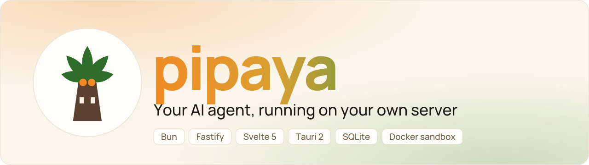
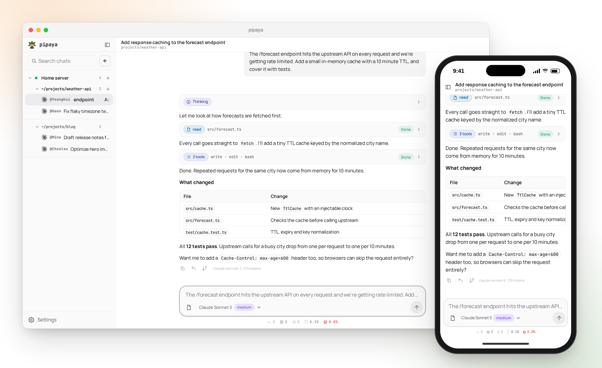

<div align="center">
  <picture>
    <source media="(prefers-color-scheme: dark)" srcset=".github/assets/banner-dark.svg" />
    
  </picture>

  <p align="center"><b>English</b> · <a href="README.ko.md">한국어</a></p>

  <p align="center"><b>An AI agent chat tool that runs on your own server.</b><br />Sessions, settings and API keys stay in your server's SQLite database. No cloud account needed.</p>

  <p align="center">
    <a href="https://bun.sh" target="_blank" rel="noreferrer"></a>
    <a href="https://fastify.dev" target="_blank" rel="noreferrer"></a>
    <a href="https://svelte.dev" target="_blank" rel="noreferrer"></a>
    <a href="https://tauri.app" target="_blank" rel="noreferrer"></a>
    <a href="https://www.typescriptlang.org" target="_blank" rel="noreferrer"></a>
    <a href="https://www.sqlite.org" target="_blank" rel="noreferrer"></a>
    
    <a href="https://discord.gg/rn3uEghsjh" target="_blank" rel="noreferrer"></a>
  </p>
</div>

<p align="center">
  <picture>
    <source media="(prefers-color-scheme: dark)" srcset=".github/assets/preview-dark.png" />
    
  </picture>
</p>

## Features

- **Agent with built-in tools**: read, write, edit, ls, grep, bash. More via extensions
- **Any model**: built-in providers, local servers (Ollama, LM Studio, llama.cpp, vLLM) or your own endpoint
- **Many devices, one conversation**: Windows, macOS, Android, web
- **Split view**: up to 8 conversations on one screen
- **Extensible**: AGENTS.md, skills, templates, sub-agents, server and client extensions

## Install

| Client | How |
|---|---|
| Windows x64 | `irm https://raw.githubusercontent.com/dohwi/pipaya/main/install.ps1 \| iex` |
| macOS (Apple Silicon) | `curl -fsSL https://raw.githubusercontent.com/dohwi/pipaya/main/install.sh \| bash -s -- client` |
| Android, Linux, web | See the [wiki](https://github.com/dohwi/pipaya-wiki) |

Windows and macOS apps bundle their own server. For a headless server (phone, web, several devices) run:

```bash
curl -fsSL https://raw.githubusercontent.com/dohwi/pipaya/main/install.sh | bash
```

Docker, configuration and everything else are in the [wiki](https://github.com/dohwi/pipaya-wiki).

## Security

The token grants **administrator** access, API keys are stored **unencrypted**, and `bash` is **not a sandbox**. Use Tailscale or HTTPS, never the open internet. Report vulnerabilities privately: [SECURITY.md](SECURITY.md).

## Development

```bash
mise install                          # Bun, Rust
cd server && bun install && bun run dev
cd client && bun install && bun run dev    # web client (port 1420)
```

See [CONTRIBUTING.md](CONTRIBUTING.md) and [`server/README.md`](server/README.md).

## License

[MIT](LICENSE)
